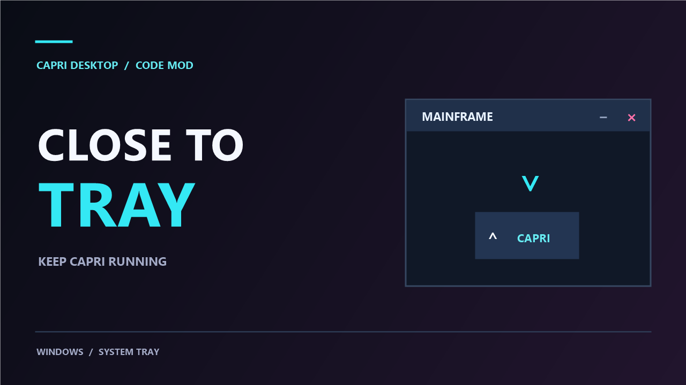

# Capri Close to Tray

A Windows code mod that lets you close Capri's Mainframe to the system tray.

-  Close (X) hides Mainframe while Capri keeps running.
- minimize (-) button minimizes Mainframe to the taskbar as usual.
- Double-click Capri's tray icon or right-click it and choose **Open Capri Mainframe** to restore the window.

If the icon appears next to the clock, drag it into the hidden icons panel (**^**). Windows controls where tray icons appear.

## Installation

1. Download [capri-close-to-tray.capri-code](capri-close-to-tray.capri-code).
2. In Capri, open **Mainframe → Mods → approve the code mod when prompted.

Windows Settings → Personalization → Taskbar → Other system tray icons → activate the slider for Capri to show Mainframe on the Right Tray side Unminimized.

Say: Hey Capri or Capri Open Mainframe to open mainframe when in Hidden Tray Mode.

The mod uses Capri's existing tray icon and makes no changes to Windows system files.

- Made by: Dominik20074
- Version: 1.0.0
